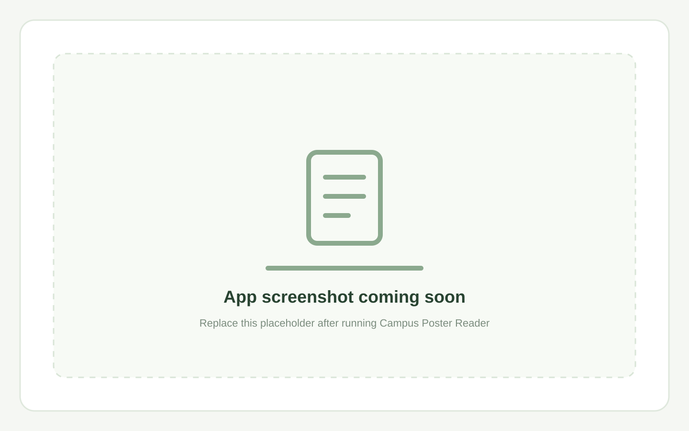

# Campus Poster Reader

Upload a campus event poster and let Gemma 4 extract its name, date, time, and location. Review and edit the details, then open a Google Calendar event or download an `.ics` file.



This project was built for the MLH/DEV Hacktoberfest 2026 Hack Day. It uses Gemma 4 image understanding through the Gemini API; the source code and its prompt are open under the MIT License.

## Requirements

- Node.js 20.19+ (or 22.12+)
- npm
- A Gemini API key from [Google AI Studio](https://aistudio.google.com/apikey)

## Run locally

1. Install dependencies from the project root:

   ```sh
   npm install
   ```

2. Copy `.env.example` to `.env` and add your API key to `GEMINI_API_KEY`.

   PowerShell:

   ```powershell
   Copy-Item .env.example .env
   ```

   Keep `.env` private. It is ignored by Git and the API key is only read by the backend.

3. Start the API and frontend together:

   ```sh
   npm run dev
   ```

4. Open the Vite URL printed in the terminal (normally `http://localhost:5173`).

The API listens on `http://localhost:3001`. Vite forwards `/api` requests to it. Check that the server is running with:

```sh
curl http://localhost:3001/api/health
```

To try extraction directly with a local image:

```sh
curl -F "poster=@/path/to/campus-poster.jpg" http://localhost:3001/api/extract
```

On Windows PowerShell, use `curl.exe` and a Windows path for the image.

## Environment variables

| Variable | Required | Default | Description |
| --- | --- | --- | --- |
| `GEMINI_API_KEY` | Yes | — | Gemini API key. Keep this on the backend and out of Git. |
| `GEMMA_MODEL` | No | `gemma-4-31b-it` | Gemma model id. `gemma-4-26b-a4b-it` is an alternative. |
| `PORT` | No | `3001` | Backend HTTP port. |
| `CLIENT_ORIGIN` | No | `*` | Allowed browser origin for the API's CORS response. Set this to your deployed frontend origin when hosting separately. |

## How Gemma 4 is used

The browser sends the selected image to `POST /api/extract` as multipart form data. The Express server keeps the file in memory and sends its inline image data plus an extraction prompt to Gemma 4 with `@google/genai`. The prompt asks for visible event details only, uses the current date and `Africa/Accra` timezone, and requests one JSON object. The server parses and validates the response before returning it to the browser.

The frontend never receives the Gemini API key. The app does not store uploads in a database or on disk. Calendar export uses the event values currently shown in the editable card. Google Calendar opens a pre-filled draft for the user to review and save; the `.ics` download can be imported into Apple Calendar or Outlook.

See [Google's Gemma on the Gemini API guide](https://ai.google.dev/gemma/docs/core/gemma_on_gemini_api) for model and image input details.

## Limitations

- A photo can be blurry, cropped, or hard to read. Gemma can misspell names or misread dates and times, so review every field before saving the event.
- The app uses the `Africa/Accra` timezone for calendar times.
- The server limits uploads to one image of at most 8 MB.
- Image content is sent to Google's Gemini API for processing; this app itself does not retain the image.
- The project needs a valid Gemini API key and network access to call the hosted model.
- No user accounts, database, or event history are included.

## License

This project is released under the [MIT License](./LICENSE).

# Hackathon-2026

# Hackathon-2026
